  <a href="https://angel.arrospide.dev">angel.arrospide.dev</a> ·
  <a href="https://www.linkedin.com/in/angelarrospide">LinkedIn</a> ·
  angel [at] arrospide [dot] dev

 

<picture>
  <source media="(prefers-color-scheme: dark)" srcset="assets/h-work-dark.svg">
  
</picture>

<a href="https://github.com/Angel-Arrospide/ML-NIDS-IIoT">
  <picture>
    <source media="(prefers-color-scheme: dark)" srcset="assets/project-nids-dark.svg">
    
  </picture>
</a>

**Talk:** [AI to Detect the Threats Firewalls Ignore](https://angel.arrospide.dev/en/notes/talks/hackandbeers/), Hack&Beers Gijón 2026.

  <a href="https://angel.arrospide.dev/en/notes"><picture><source media="(prefers-color-scheme: dark)" srcset="assets/card-notes-dark.svg"></picture></a>
  <a href="https://angel.arrospide.dev/en/now"><picture><source media="(prefers-color-scheme: dark)" srcset="assets/card-now-dark.svg"></picture></a>
  <a href="https://angel.arrospide.dev/en/manifesto"><picture><source media="(prefers-color-scheme: dark)" srcset="assets/card-manifesto-dark.svg"></picture></a>
  <a href="https://angel.arrospide.dev/en/cv"><picture><source media="(prefers-color-scheme: dark)" srcset="assets/card-cv-dark.svg"></picture></a>

 

<picture>
  <source media="(prefers-color-scheme: dark)" srcset="assets/h-now-dark.svg">
  
</picture>

- Studying the Double Master's Degree in Computer Engineering and Cybersecurity at **UC3M**.
- Writing a paper on my Bachelor's thesis: ML-based NIDS for Industrial IoT running at the edge.
- Taking the **Stanford Advanced Cybersecurity Program**.
- Reading *A Mathematical Framework for Transformer Circuits*.

Assets are generated by <code>scripts/build.py</code> in the style of <a href="https://angel.arrospide.dev">my website</a>.
